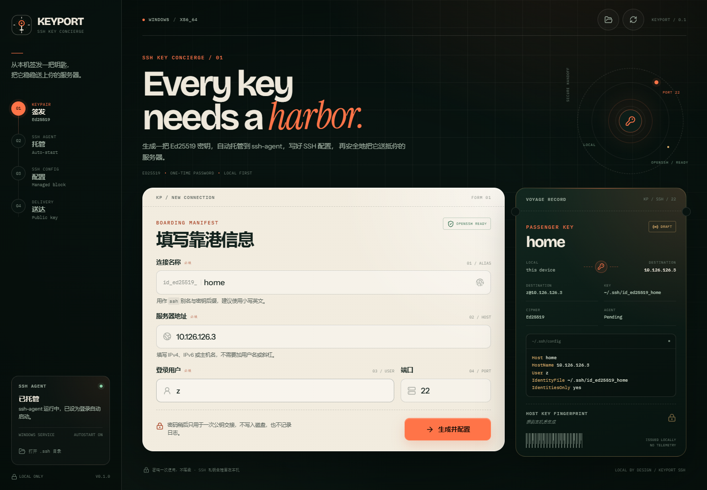
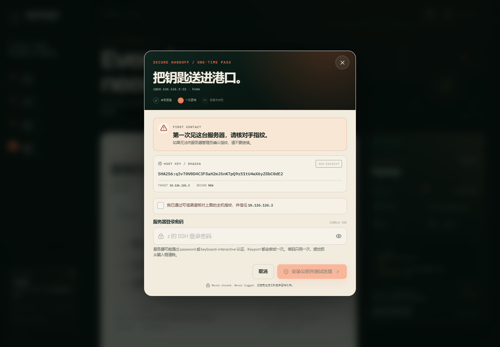
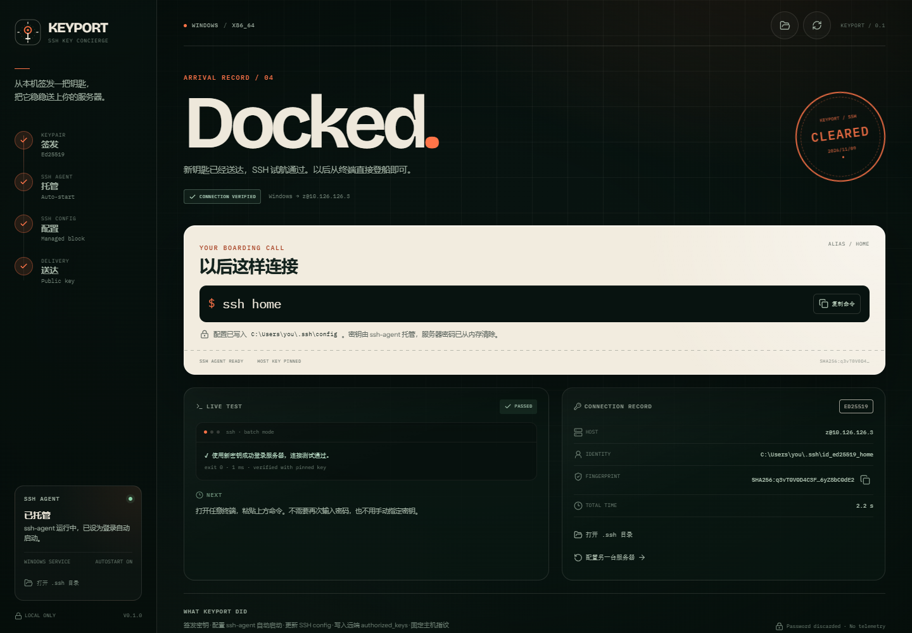

# Keyport SSH

> 一把钥匙，需要一座港口。<br>
> A cross-platform SSH key concierge for Windows, macOS and Linux.

Keyport SSH 是一个用 **Rust + Tauri 2 + React** 编写的桌面应用。它把「生成 SSH
密钥、托管 ssh-agent、写 SSH config、把公钥送到服务器、验证连接」这一串容易出错的
手工步骤，收进一个清晰、可检查的流程里。

<div align="center">
  
  <p><sub>界面预览 · 浏览器 mock 数据渲染，真实运行时会读写本机与服务器</sub></p>
</div>

## 功能

- **Ed25519 密钥签发**：使用系统 `ssh-keygen` 生成 `~/.ssh/id_ed25519_<连接名>`，
  不覆盖任何已有密钥。
- **OpenSSH 环境检查与自动安装**：缺少 OpenSSH 时，Windows 自动请求安装
  `OpenSSH.Client` 可选功能，Linux 通过 `pkexec` + 发行版包管理器安装；macOS
  提示 Xcode Command Line Tools / Homebrew。
- **ssh-agent 自动托管**：
  - Windows：配置并启动 `ssh-agent` 服务，启动类型设为自动；
  - macOS：安装 `launchd` LaunchAgent，登录时启动；
  - Linux：安装 systemd user unit，系统没有 systemd 时使用 XDG Autostart 回退；
  - 自动把刚生成的密钥加入 agent，并在 shell 配置中维护带标记的
    `SSH_AUTH_SOCK` 块。
- **SSH config 托管块**：写入带标记且可重复更新的配置块，包含示例中的
  `Host / HostName / User / IdentityFile / IdentitiesOnly / BatchMode /
  ServerAliveInterval`，并自动处理非 22 端口。
- **一次性密码交接**：通过纯 Rust SSH 客户端完成密码认证，公钥以幂等方式追加到
  远端 `~/.ssh/authorized_keys`。密码不会写盘、不会记日志，命令结束后主动释放
  内存中的引用。
- **主机指纹钉住**：首次连接必须显式核对并信任服务器主机指纹；已记录的
  `known_hosts` 指纹不一致时直接中止，绝不把密码发给可能被冒充的主机。
- **自动试航**：使用新写入的配置执行真实的 `ssh` 连接测试，成功后展示以后可直接
  使用的 `ssh <连接名>` 命令。
- **失败可恢复**：密钥、agent、配置、公钥安装分阶段反馈；安装公钥后测试失败也能
  保留状态并重试测试。

<details>
<summary><strong>查看一次性密码交接与抵达界面</strong></summary>

### 安全交接



首次连接先展示服务器主机指纹，用户确认后才能输入一次性密码；`known_hosts`
冲突时窗口会直接停止交接。

### 抵达



SSH 试航通过后展示可直接粘贴到终端的连接命令、连接档案与测试结果。

</details>

## 安全模型

Keyport 处理的是服务器的入口凭证，因此这里的几个设计是刻意的：

| 风险 | 处理方式 |
| --- | --- |
| 覆写已有私钥 | 发现同名私钥时拒绝继续，只允许用户显式选择复用 |
| 覆写非托管 SSH 配置 | 遇到同名且不在 Keyport 托管块中的 `Host` 时中止，并给出提示 |
| 中间人攻击 | 探测主机指纹 → 用户核对 `SHA256` 指纹 → 密码认证前在 SSH handler 内再次比对指纹 |
| 已知主机被替换 | `known_hosts` 中指纹冲突时无条件中止，不使用 `accept-new` 悄悄放行 |
| 密码落盘 | 密码只存在于 React state / Rust 参数 / SSH 认证栈中；提交后立即清空输入框，Rust 侧用 `Zeroizing<String>` 包裹，不写日志、不进错误详情 |
| 沉默的失败 | 每一步都有可读错误、技术详情与恢复建议；密码错误时允许直接重试 |
| 遥测 | 没有遥测，没有云端服务，没有账号 |

> 初始公钥交接要求服务器仍开放密码登录（password 或 keyboard-interactive）。
> 完成交接后，Keyport 的配置使用 `IdentityFile` + `IdentitiesOnly yes`，不依赖
> agent 才能建立连接。

## 平台支持

| 平台 | 最低版本 | ssh-agent 自启方式 | 备注 |
| --- | --- | --- | --- |
| Windows 10/11 | Windows 10 1809+ | OpenSSH Authentication Agent 服务 | 修改服务需要 UAC 授权；自动安装通过 Windows 可选功能 |
| macOS | 10.15+ | `~/Library/LaunchAgents/dev.keyport.ssh-agent.plist` | 需要 Xcode Command Line Tools（通常已随系统提供） |
| Linux | 主流桌面发行版 | systemd user unit / XDG Autostart 回退 | 通过 `pkexec` 安装 OpenSSH；依赖 WebKitGTK 运行 Tauri |

服务器端当前支持使用 POSIX shell 的 OpenSSH 服务端（Linux、macOS、BSD 等）。
Windows OpenSSH Server 的默认 `cmd` shell 尚未适配，因为公钥安装命令使用
`$HOME`、`grep` 与 `chmod`。

### 尚未支持

- 带口令的私钥生成/导入（当前生成空口令密钥，由 `0600` 文件权限和 agent 保护）；
- SSH 主机证书（host certificate）；
- 已经配置了非托管 `Host <同名>` 的条目自动迁移（Keyport 会明确报冲突，不擅自改）；
- 远端清理或吊销公钥的图形化流程；
- ProxyJump / ProxyCommand 的图形化配置（手写配置块不会被 Keyport 改动）。

## 快速开始（开发）

### 前置要求

- Node.js 20+
- pnpm 8+
- Rust stable `1.89+`
- Tauri 2 对应平台依赖：
  - **Windows**：Microsoft C++ Build Tools + WebView2 Runtime；应用运行时还需要
    OpenSSH Client（Keyport 可引导安装）。
  - **macOS**：Xcode Command Line Tools。
  - **Linux**：`libwebkit2gtk-4.1-dev`、`libappindicator3-dev`、`librsvg2-dev`、
    `patchelf`、`build-essential`。

### 安装依赖并运行

```bash
pnpm install
pnpm tauri dev
```

仅预览前端界面（开发服务器会使用内置的 mock 数据，不会修改本机 SSH 文件）：

```bash
pnpm dev
```

> Mock 只在浏览器开发/显式预览构建中启用。生产 Tauri 构建如果检测不到 IPC，
> 会显示错误而不是伪造操作成功。

### 检查与构建

```bash
pnpm typecheck
pnpm build
cd src-tauri && cargo test && cargo clippy --all-targets -- -D warnings
pnpm tauri build
```

Tauri 会在 `src-tauri/target/release/bundle/` 下生成平台安装包。

## 应用会修改哪些文件？

所有改动都是本机的明文、可审计文件：

| 路径 | 变更 |
| --- | --- |
| `~/.ssh/id_ed25519_<name>` / `.pub` | 生成新的 Ed25519 密钥对 |
| `~/.ssh/config` | 前置写入带 `# >>> keyport:<name>` / `# <<< keyport:<name> <<<` 标记的托管块；首次修改前创建 `config.keyport.bak` |
| `~/.ssh/known_hosts` | 用户首次信任主机后追加主机公钥 |
| `~/.ssh/authorized_keys`（远端） | 幂等追加公钥行 |
| Windows `ssh-agent` 服务 | 启动类型设为 `Automatic` 并启动服务 |
| macOS `~/Library/LaunchAgents/dev.keyport.ssh-agent.plist` | LaunchAgent 定义 |
| Linux `~/.config/systemd/user/keyport-ssh-agent.service` 或 `~/.config/autostart/dev.keyport.ssh-agent.desktop` | agent 自启定义 |
| `~/.zshrc` / `~/.bashrc` / `~/.profile` / fish `conf.d` | 维护一个 `# >>> keyport ssh-agent` shell 块，仅在 `SSH_AUTH_SOCK` 为空时指向 Keyport agent |
| `~/.local/bin/keyport-ssh-agent`（仅无 systemd 的 Linux 回退） | 启动助手脚本 |

Keyport 采用托管块而不是重写整个配置文件；遇到不完整或冲突的标记会中止，而不会猜测并删除用户内容。

## 架构

```text
┌──────────────────────── WebView (React 19 + Vite) ───────────────────────┐
│  ManifestForm  →  PreparedCard  →  AccessModal  →  ResultView            │
│  demo mock / typed API client (src/lib/api.ts)                            │
└──────────────────────────────┬───────────────────────────────────────────┘
                               │ Tauri IPC
┌──────────────────────────────▼───────────────────────────────────────────┐
│ Rust (src-tauri/src)                                                     │
│  commands.rs        orchestration + one-time password boundary           │
│  validation.rs      defensive input normalization                         │
│  keygen.rs          ssh-keygen + public key parsing/fingerprints          │
│  ssh_config.rs      managed, idempotent ~/.ssh/config blocks              │
│  agent_windows.rs   OpenSSH service + UAC                                 │
│  agent_unix.rs      launchd / systemd / XDG autostart + shell integration │
│  remote.rs          host probe, pinned SSH handler, password auth,        │
│                     authorized_keys install, known_hosts, ssh test        │
└──────────────────────────────────────────────────────────────────────────┘
```

Rust 端不信任 UI 传来的路径或公钥：完成步骤会根据连接名重新发现
`~/.ssh/id_ed25519_<name>`、重新验证密钥、重新写入托管配置，再进行密码交接。

## GitHub Actions

- `.github/workflows/ci.yml`：前端类型检查/构建 + Rust 测试/Clippy + 三平台应用编译；
- `.github/workflows/release.yml`：推送 `v*` 标签时构建 Windows、Linux 与
  macOS（universal）安装包，并创建 GitHub Release。

## License

[MIT](LICENSE)。直接依赖与字体许可见
[THIRD_PARTY_NOTICES.md](THIRD_PARTY_NOTICES.md)。
